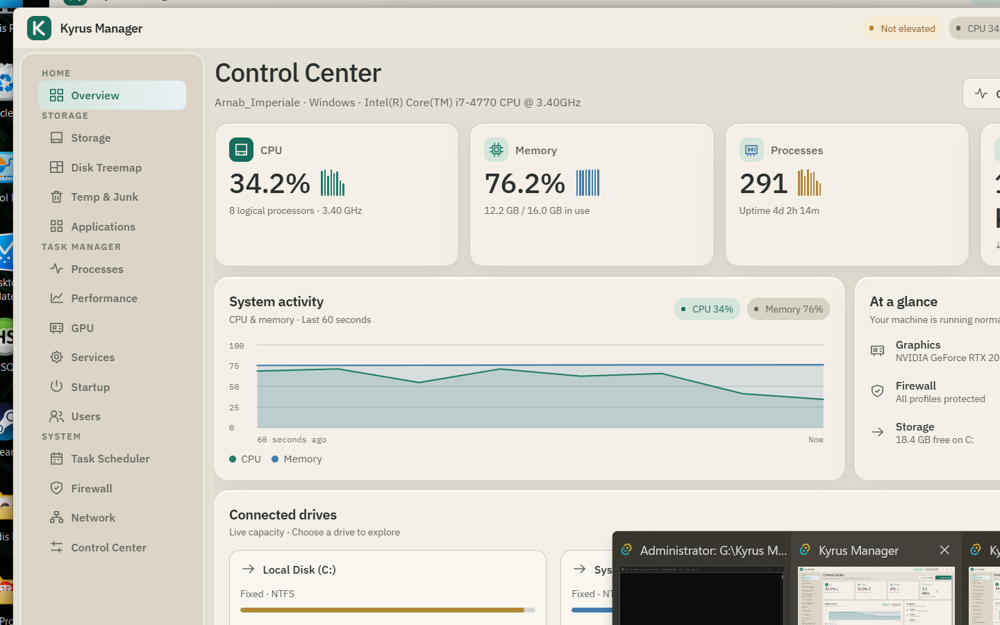
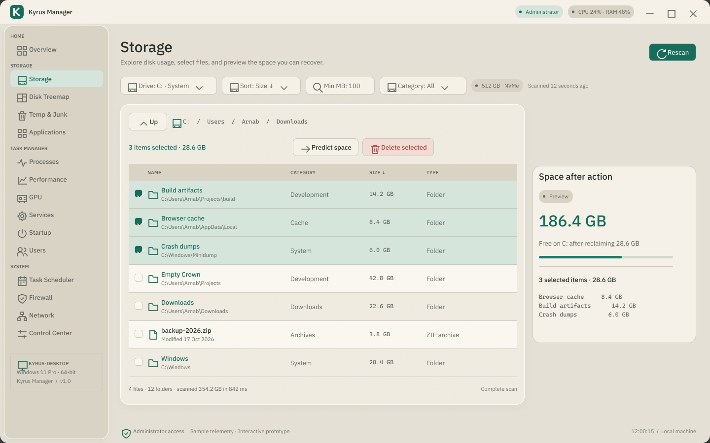
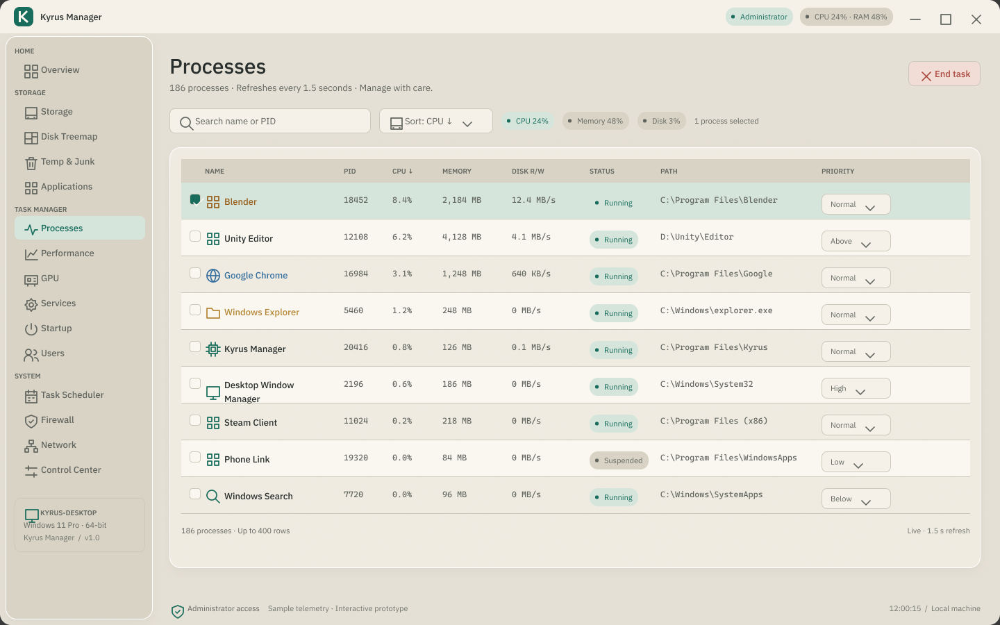
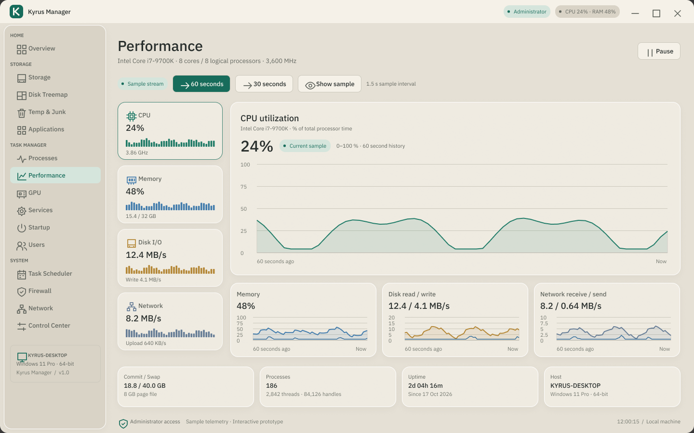
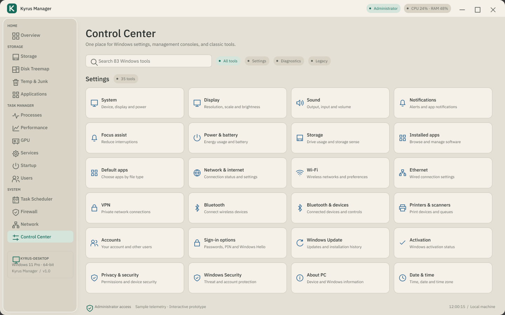
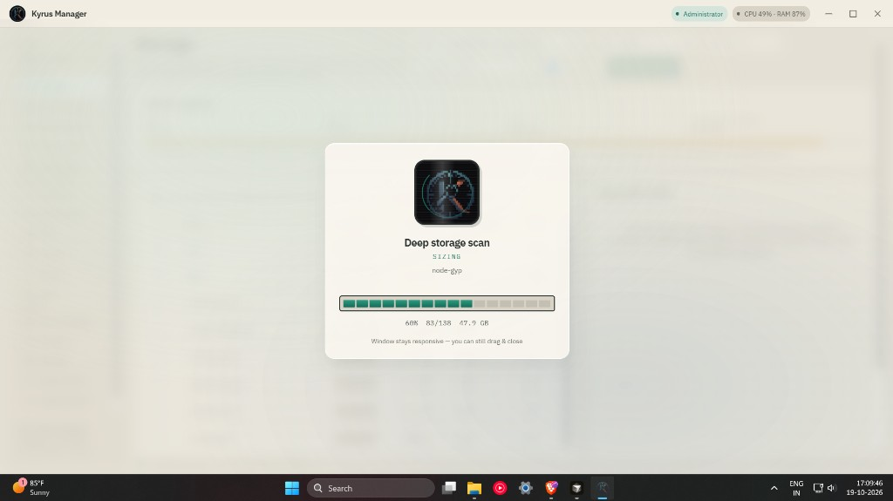

<p align="center">
  
</p>

<h1 align="center">Kyrus Manager</h1>

<p align="center">
  A native Windows system control center.<br />
  Storage, processes, disks, devices, services, firewall, and more — without the opaque MMC consoles.
</p>

<p align="center">
  <a href="https://github.com/arnabpluxury/kyrus-manager/releases/latest"></a>
  <a href="https://github.com/arnabpluxury/kyrus-manager/releases"></a>
  <a href="LICENSE"></a>
  <a href="#requirements"></a>
</p>

<p align="center">
  <a href="https://github.com/arnabpluxury/kyrus-manager/releases/latest"></a>
  &nbsp;
  <a href="https://github.com/arnabpluxury/kyrus-manager/releases/latest"></a>
</p>

---

<p align="center">
  
</p>

## What it is

Windows ships the tools. Task Manager, Disk Management, Device Manager, Event Viewer, Services — they work, but they are scattered, dated, and often hide half the story behind elevation prompts and empty columns.

Kyrus Manager puts those surfaces in one local app: cream-glass UI, live telemetry, real folder sizes, and actions that report exactly what they did. No cloud account. No telemetry phone-home. Release builds request Administrator so protected volumes and services are actually reachable.

Stack: **Tauri 2 · React · TypeScript · Rust**.

## Highlights

| Area | What you get |
| --- | --- |
| Storage | Full recursive sizes (Steam, Program Files, Users…), drive reconciliation, predict reclaim, delete with progress |
| Disks | Disk Management stand-in: online/offline, read-only, letters, GPT init, volumes |
| Task Manager | Processes with suspend / end tree / priority; Performance; GPU; Services with icons |
| Admin Console | Win+X tools in-app: Power plans, Event logs, System About, Devices, Network |
| Bloatware Free | Scan AppX / provisioned OEM / Defender hits / noisy services — select and remove |
| Control Center | 80+ Settings / MMC / diagnostics launchers, grouped and searchable |
| Preferences | Instant light / dark, gradients, compact nav |

<p align="center">
  
  &nbsp;
  
</p>

<p align="center">
  
  &nbsp;
  
</p>

<p align="center">
  
</p>

<p align="center"><sub>Long work stays on a dimmed overlay with live percent, item counts, and bytes — the window remains draggable.</sub></p>

## Install

Grab the latest build from [Releases](https://github.com/arnabpluxury/kyrus-manager/releases/latest).

| Package | Use when |
| --- | --- |
| `Kyrus Manager_*_x64_en-US.msi` | Corporate / Group Policy friendly install |
| `Kyrus Manager_*-setup.exe` | Classic NSIS wizard |

Both are x64. Prefer running elevated for complete disk and service access.

```text
Verify after install: open Storage → Deep scan on C:\
You should see large trees (e.g. Steam, Users) and a progress sheet while sizing.
```

## Develop from source

```bash
npm install
npm run tauri dev
```

Production installers (clears previous MSI/NSIS first):

```bash
npm run tauri:build:fresh
```

Artifacts land in:

```text
src-tauri/target/release/bundle/msi/
src-tauri/target/release/bundle/nsis/
```

### Requirements

- Windows 10 or 11 (x64)
- [Node.js 20+](https://nodejs.org/) and [Rust](https://rustup.rs/) for development
- WebView2 (ships with modern Windows)
- Administrator recommended for pagefile, System Volume Information, and OEM AppX removal

## Project layout

```text
src/                 React UI (views, cream tokens, preferences)
src-tauri/src/       Rust commands (storage, winmgmt, bloatware, services…)
docs/readme/         Screenshots used in this file
docs/figma-refs/     Design reference exports
```

UI tokens: `src/styles/tokens.css`.  
Destructive actions always confirm and surface partial failures — nothing silent.

## Contributing

Pull requests are welcome if they keep the cream-glass language, prefer real Windows APIs over mocks, and leave long operations on the progress overlay.

If you change the code and distribute those changes — or use them commercially — you must publish the modified sources under the project license. Details: [TERMS.md](TERMS.md).

## License

**Kyrus Manager Source License (Open Contribution)**  
Personal and non-commercial use is fine. Shared or commercial use of modifications requires open-sourcing those changes. Full text: [LICENSE](LICENSE).

---

<p align="center">
  <a href="https://github.com/arnabpluxury/kyrus-manager/issues">Issues</a>
  ·
  <a href="https://github.com/arnabpluxury/kyrus-manager/releases">Releases</a>
  ·
  <a href="TERMS.md">Terms</a>
</p>
