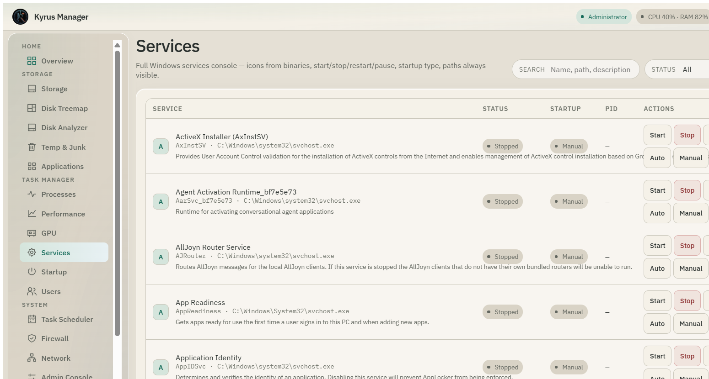
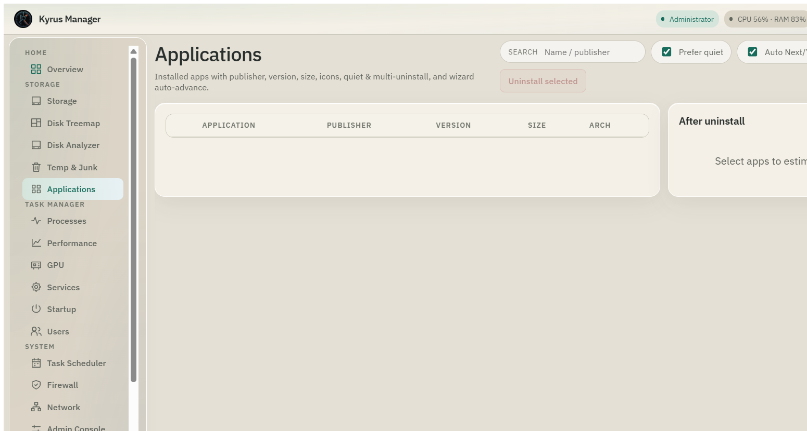
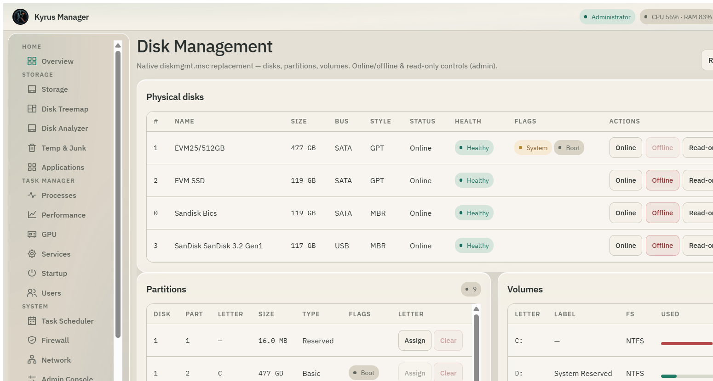
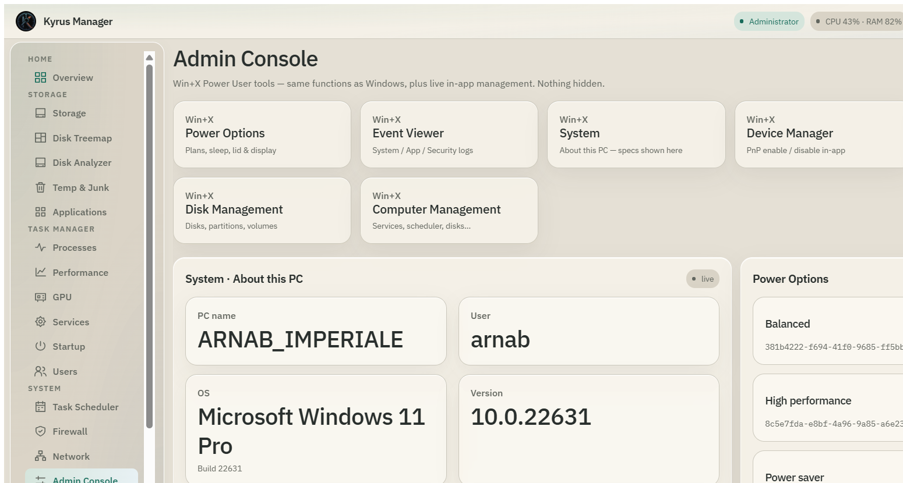
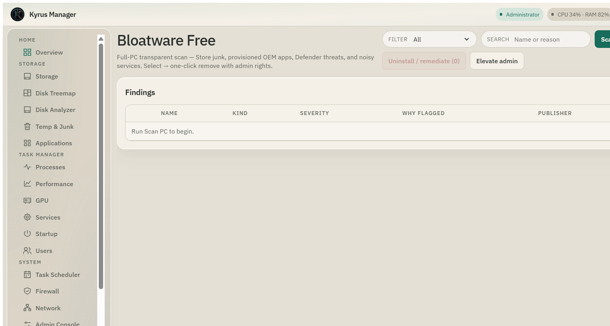

<p align="center">
  
</p>

<h1 align="center">Kyrus Manager</h1>

<p align="center">
  Native Windows system control center.<br />
  Storage, processes, disks, devices, services, firewall — one local app instead of a maze of MMC consoles.
</p>

<p align="center">
  <a href="https://github.com/arnabpluxury/kyrus-manager/releases/latest"></a>
  <a href="https://github.com/arnabpluxury/kyrus-manager/releases"></a>
  <a href="LICENSE"></a>
  
</p>

<p align="center">
  <a href="https://github.com/arnabpluxury/kyrus-manager/releases/latest"></a>
  &nbsp;
  <a href="https://github.com/arnabpluxury/kyrus-manager/releases/latest"></a>
  &nbsp;
  <a href="https://ko-fi.com/arnabimperiale"></a>
</p>

---

<p align="center">
  
</p>
<p align="center"><sub>Overview — live CPU, memory, processes, drives, and at-a-glance health</sub></p>

## Screenshots

<table>
  <tr>
    <td width="50%" valign="top">
      
      <p align="center"><b>Processes</b><br /><sub>End task / tree · suspend · priority · full paths</sub></p>
    </td>
    <td width="50%" valign="top">
      
      <p align="center"><b>Performance</b><br /><sub>Live charts for CPU, memory, and I/O</sub></p>
    </td>
  </tr>
  <tr>
    <td width="50%" valign="top">
      
      <p align="center"><b>Services</b><br /><sub>Icons · start/stop/restart · startup type · paths</sub></p>
    </td>
    <td width="50%" valign="top">
      
      <p align="center"><b>Applications</b><br /><sub>Installed apps with icons and quiet uninstall</sub></p>
    </td>
  </tr>
  <tr>
    <td width="50%" valign="top">
      
      <p align="center"><b>Disk Management</b><br /><sub>Disks, partitions, volumes · online/offline · letters</sub></p>
    </td>
    <td width="50%" valign="top">
      
      <p align="center"><b>Admin Console</b><br /><sub>Win+X tools with live Event Viewer &amp; power plans</sub></p>
    </td>
  </tr>
  <tr>
    <td width="50%" valign="top">
      
      <p align="center"><b>Control Center</b><br /><sub>80+ Settings / MMC / diagnostics launchers</sub></p>
    </td>
    <td width="50%" valign="top">
      
      <p align="center"><b>Bloatware Free</b><br /><sub>AppX · provisioned OEM · threats · noisy services</sub></p>
    </td>
  </tr>
</table>

<p align="center">
  
</p>
<p align="center"><sub>Deep scans and deletes use a dimmed overlay with live percent, counts, and bytes — window stays draggable</sub></p>

## What it does

Windows already has Task Manager, Disk Management, Device Manager, Event Viewer, and Services. They work — but they are scattered, dated, and often hide detail behind elevation prompts.

Kyrus Manager keeps that work on one machine, in one cream-glass shell: real recursive folder sizes, transparent bloatware reasons, and actions that report what they did. No account. No cloud. Release builds request Administrator so protected volumes and services are reachable.

Built with **Tauri 2 · React · TypeScript · Rust**.

| Area | Capabilities |
| --- | --- |
| Storage | Deep recursive sizes, drive reconciliation, reclaim prediction, delete with progress |
| Disks | Physical disks / partitions / volumes, online·offline, read-only, letters, GPT init |
| Task Manager | Processes (suspend, end tree, priority), Performance, GPU, Services with icons |
| Admin Console | Power plans, Event logs, System About, Devices, Network adapters |
| Bloatware Free | AppX + provisioned packages + Defender hits + telemetry-ish services |
| Shell | Instant light / dark, preferences, hidden PowerShell (no console flash) |

## Install

Latest packages: [Releases](https://github.com/arnabpluxury/kyrus-manager/releases/latest)

| Asset | Notes |
| --- | --- |
| `Kyrus Manager_*_x64_en-US.msi` | Windows Installer |
| `Kyrus Manager_*-setup.exe` | NSIS wizard |

x64 only. Prefer elevated installs for full disk and service access.

## Develop

```bash
npm install
npm run tauri:dev
```

Fresh installers (clears previous MSI/NSIS first):

```bash
npm run tauri:build:fresh
```

Requires Node 20+, Rust, Windows 10/11, and WebView2.

## Support

If Kyrus Manager saves you time, you can support development here:

<p align="center">
  <a href="https://ko-fi.com/arnabimperiale"></a>
</p>

Same Ko-fi as [Agentic Dev Prompts](https://github.com/arnabpluxury/Agentic-Dev-Prompts). Optional — the app stays free under the project license.

## Contributing

Keep the cream-glass language, prefer real Windows APIs, and run long work on the progress overlay.  

If you modify the project and distribute those changes — or use them commercially — publish the modified sources. See [TERMS.md](TERMS.md).

## License

**Kyrus Manager Source License (Open Contribution)** — personal / non-commercial use is fine; shared or commercial modifications must be open-sourced. Full text: [LICENSE](LICENSE).

---

<p align="center">
  <a href="https://github.com/arnabpluxury/kyrus-manager/issues">Issues</a>
  ·
  <a href="https://github.com/arnabpluxury/kyrus-manager/releases">Releases</a>
  ·
  <a href="https://ko-fi.com/arnabimperiale">Ko-fi</a>
  ·
  <a href="TERMS.md">Terms</a>
</p>
